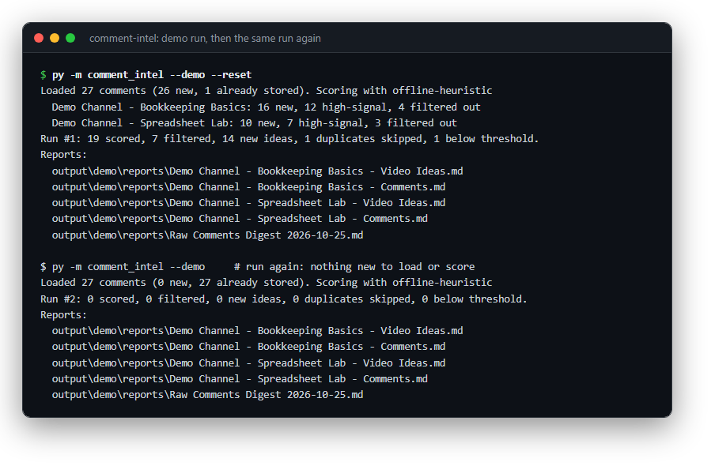
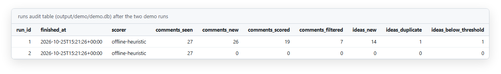
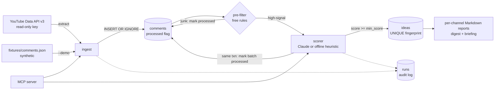
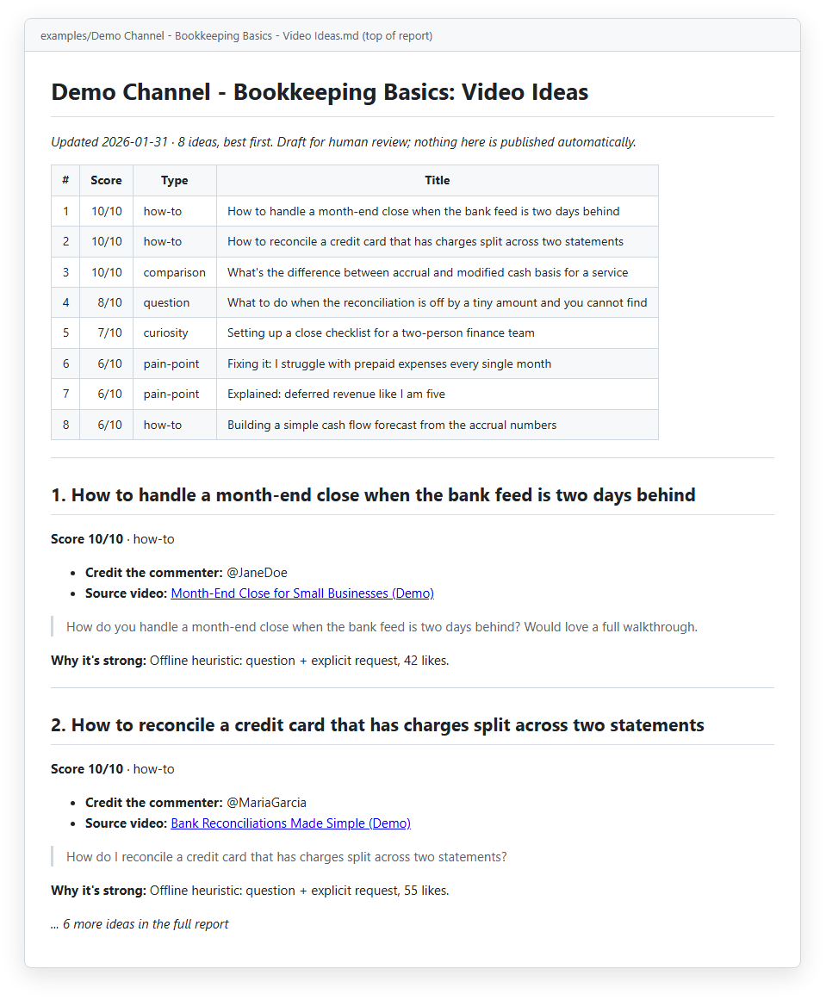

# comment-intel

**5,000+ viewer comments turned into 1,100+ ranked content ideas, without paying to read the same comment twice.**


*The offline demo, run twice: the first run loads, filters and scores the synthetic comments; the second finds 0 new and scores 0.*

It's a daily ETL pipeline with LLM scoring. Raw YouTube comments go in, and a ranked, de-duplicated idea ledger comes out. I built it with the same load-once, score-once, report-from-the-ledger habits I'd use on a transaction pipeline.

The headline numbers come from the version I run on 3 of my own channels, as a daily Windows Task Scheduler job. This repo runs the same code on synthetic comments.

## The problem

A comment section is a high-volume, low-quality feed of unstructured records. Think of a bank feed full of noise. The useful items (a real question, a pain point people keep repeating) are buried, and the same comment comes back on every pull. Paying an LLM to re-read every row each day would be slow and expensive.

So I treated it like a close. Each record gets ingested exactly once. Cheap filters run before the expensive step, nothing gets double-counted, and every run leaves an audit trail.

## What it does

- **Extract:** pulls top-level comments for each configured channel from the YouTube Data API v3, using a read-only key, with paging and bounded exponential back-off on 429/5xx errors.
- **Load:** writes them to SQLite with `INSERT OR IGNORE` on the comment ID, so pulling the same comment again does nothing.
- **Filter:** a free rule-based pre-filter (likes, length, is it a question) drops junk like "first!" before any API spend.
- **Score:** sends high-signal comments to Claude (`claude-haiku-4-5` by default, configurable) in batches. Claude returns structured JSON: title, 1-10 score, category, rationale, and the index of the source comment.
- **De-duplicate ideas:** stores each idea under a SHA1 fingerprint of its normalized title with a `UNIQUE` constraint, so two viewers asking the same thing produce one idea, not two.
- **Report:** writes per-channel Markdown reports (ranked ideas linked back to commenter and source video, plus the raw comment feed), a cross-channel digest, and an optional exactly-once briefing.
- **On demand:** the same pipeline is exposed as an MCP server (`scan_comments`, `generate_ideas`, `get_briefing`), so an assistant can run it inside a chat.

## Controls

| Control | How it's enforced |
|---|---|
| Idempotent ingest | `comment_id` is the primary key, loaded with `INSERT OR IGNORE`. Re-running a day loads nothing new (tested). |
| Score each record once | A `processed` flag is set only for the exact comment IDs in a batch, in the **same transaction** as that batch's ideas. |
| Failure-safe batches | If the LLM call fails mid-run, finished batches stay committed and the rest stay unprocessed for the next run. Nothing is lost or scored twice (tested with a simulated outage). |
| Duplicate detection | `ideas.fingerprint` = SHA1 of the lower-cased, punctuation-stripped title, `UNIQUE`. Duplicates are counted and reported, not silently dropped. |
| Materiality threshold | Ideas scoring below `llm.min_score` are not stored. The count shows in the run summary. |
| Cost control | The pre-filter runs before any API call. Filtered rows are still marked processed, so they are never re-evaluated. |
| Exactly-once delivery | The briefing flags only the idea IDs it actually wrote as `delivered`, never a blanket update. |
| Audit log | Every run writes a `runs` row: mode, scorer, comments seen/new/scored/filtered, ideas new/duplicate/below threshold, and start/finish timestamps. A run with no `finished_at` is a run that failed. |
| Lineage | Every idea carries its source comment, commenter and video, so each line on the report traces back to source. |
| Read-only | Read-only API key, no OAuth, no write scopes. It never replies, posts or edits. Reports are for a human to read and act on. |
| Model output validation | LLM JSON is parsed defensively: scores clamped to 1-10, unknown categories normalized, malformed replies return an empty list rather than crashing the run. |
| No secrets in code | Keys come only from environment variables or `.env` (git-ignored). See `.env.example`. |


*The `runs` audit table: one row per run with control counts and a finish timestamp. Run #2 is the idempotent re-run.*

## Architecture



The scorer is a small interface (`score(channel, comments) -> ideas`). `ClaudeScorer` calls the Messages API. `HeuristicScorer` is a deterministic offline stand-in with the same output shape, which is how the whole pipeline gets tested without a network.

## Quickstart

Demo mode needs no keys and runs fully offline on bundled synthetic comments for two fictional channels. Without an `ANTHROPIC_API_KEY` it uses the deterministic offline scorer. Reports go to `output/demo/reports/` (git-ignored). Requires Python 3.10+.

**Windows (PowerShell):**

```powershell
git clone https://github.com/markvalderrama001-svg/comment-intel.git
cd comment-intel
py -m venv .venv
.venv\Scripts\python -m pip install -r requirements.txt
.venv\Scripts\python -m comment_intel --demo --reset
.venv\Scripts\python -m comment_intel --demo     # run again: 0 new, 0 scored (idempotent)
.venv\Scripts\python -m pytest -q
```

<details>
<summary>macOS / Linux (bash)</summary>

```bash
git clone https://github.com/markvalderrama001-svg/comment-intel.git
cd comment-intel
python3 -m venv .venv
.venv/bin/python -m pip install -r requirements.txt
.venv/bin/python -m comment_intel --demo --reset
.venv/bin/python -m comment_intel --demo
.venv/bin/python -m pytest -q
```

</details>

Expected output of the first demo run:

```text
Loaded 27 comments (26 new, 1 already stored). Scoring with offline-heuristic
  Demo Channel - Bookkeeping Basics: 16 new, 12 high-signal, 4 filtered out
  Demo Channel - Spreadsheet Lab: 10 new, 7 high-signal, 3 filtered out
Run #1: 19 scored, 7 filtered, 14 new ideas, 1 duplicates skipped, 1 below threshold.
```

A committed sample of the output is in [`examples/demo-channel-video-ideas.md`](examples/demo-channel-video-ideas.md). It is the demo's Bookkeeping Basics report. A test regenerates it and compares it byte for byte, so if the demo ever stops being deterministic, the suite fails.


*The committed sample report: ranked ideas with score, type, the commenter to credit and a link back to the source video.*

Useful flags: `--offline` (force the heuristic scorer even when a key is set), `--briefing` (also write the exactly-once briefing), `--as-of YYYY-MM-DD` (fixed report date), `--out DIR`, `--config PATH`.

## Live mode

1. Copy `.env.example` to `.env` and set `YOUTUBE_API_KEY` (Google Cloud console, enable YouTube Data API v3, create an API key) and `ANTHROPIC_API_KEY`.
2. In `config.yaml`, replace the placeholder `channels` with your own channel IDs (the `UC...` value in YouTube Studio > Settings > Channel > Advanced).
3. Run `py -m comment_intel` (Windows) or `python3 -m comment_intel`.

The first run backfills `max_videos_backfill` videos per channel. Later runs check the latest `max_videos_daily`. To change the model, set `llm.model` or the `COMMENT_INTEL_MODEL` environment variable.

**Schedule it daily (Windows Task Scheduler):** Create Basic Task > Daily > Start a program. Program: `<repo>\.venv\Scripts\python.exe`, arguments: `-m comment_intel`, start in: `<repo>`. On macOS/Linux, a cron line does the same job. Every run is idempotent, so a missed or doubled schedule does no harm.

**MCP server (optional):** `py mcp_server/server.py` exposes `scan_comments`, `generate_ideas` and `get_briefing` over stdio. Set `COMMENT_INTEL_DEMO=1` to point it at the synthetic fixtures and demo database. The requirements pin `mcp<2` because the server imports `FastMCP` from the 1.x SDK (`mcp.server.fastmcp`), and I don't want a future major release to break that import without warning.

## Tests

`pytest` runs fully offline, with the YouTube client and the Anthropic client both faked. Coverage:

- dedup and fingerprinting (case and punctuation collapse, `INSERT OR IGNORE`, the processed flag surviving a re-fetch, the `UNIQUE` idea constraint)
- the pre-filter boundaries
- LLM reply parsing and validation
- API paging and retry back-off
- report rendering (ranking, Markdown escaping, lineage links, exactly-once briefing)
- end-to-end demo: counts, idempotent second run, recovery from a simulated mid-run API outage, a byte-for-byte match with the committed example, and the CLI with no key set

## Project structure

```text
comment-intel/
├── comment_intel/
│   ├── youtube_client.py     # extract: channels -> uploads playlist -> comment threads
│   ├── store.py              # load: SQLite schema, INSERT OR IGNORE, fingerprints, audit runs
│   ├── intelligence.py       # transform: pre-filter, prompt, JSON parsing, ClaudeScorer
│   ├── demo.py               # fixture source + deterministic HeuristicScorer
│   ├── pipeline.py           # orchestration and transactional batch scoring
│   ├── per_channel_report.py # ranked ideas + comment feed per channel (Markdown)
│   ├── comments_digest.py    # cross-channel raw comment digest
│   ├── briefing.py           # exactly-once briefing of undelivered ideas
│   └── run_pipeline.py       # CLI (--demo, --offline, --reset, --briefing, ...)
├── mcp_server/server.py      # MCP tools over the same pipeline
├── fixtures/comments.json    # synthetic comments for two fictional channels
├── examples/                 # one committed sample report (from synthetic data)
├── docs/                     # README screenshots
├── tests/                    # offline pytest suite (no network, no keys)
├── config.yaml               # channels (placeholders), thresholds, model, paths
├── .env.example
├── .gitattributes
└── pyproject.toml / requirements.txt
```

Independent project. Not affiliated with or endorsed by YouTube or Google; names are used only to describe what the code connects to.

---

**About.** Mark Valderrama, CPA · Finance Engineer. I run the production version in my own businesses. [LinkedIn](https://www.linkedin.com/in/markvalderrama/)

MIT License, see [LICENSE](LICENSE).
